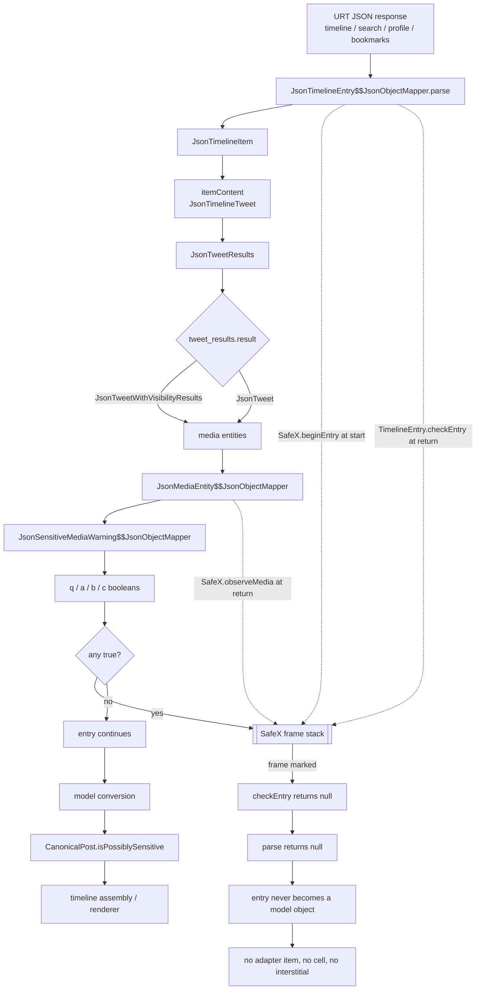

# SafeX — data and control flow

## Where X decides, and where SafeX intervenes



## Two independent paths (the important asymmetry)

| Path | Trigger | Covered by SafeX today |
|---|---|---|
| Cold / network | JSON parsed through `JsonTimelineEntry` mapper | **Yes** — entry dropped at parse |
| Warm cache | models hydrated from Strato without JSON parse | **No** — see STATUS.md gap 2 |

The model flag `com.x.models.CanonicalPost.isPossiblySensitive` is serialized with
the post, so it survives caching; the JSON hook cannot see it. A second
interception point on the hydration path is required for full coverage.

## Injection points (exact)

| Injection | Method | Location |
|---|---|---|
| `SafeX.beginEntry()` | `JsonTimelineEntry$$JsonObjectMapper.parse(JsonParser): Object` | instruction 0 |
| `SafeX.beginEntry()` | `JsonTimelineModuleItem$$JsonObjectMapper.parse(JsonParser): Object` | instruction 0 |
| `SafeX.observeMedia(Object)` | `JsonMediaEntity$$JsonObjectMapper.parse(JsonParser): Object` | immediately before `RETURN_OBJECT` |
| `SafeX.endEntry()` | `TimelineEntry.checkEntry(...)` (extension, called at entry parse return) | extension code |

Resulting decompiled entry parser:

```java
public JsonTimelineEntry parse(h) {
    SafeX.beginEntry();
    return TimelineEntry.checkEntry(parse(h));
}
```

## Failure containment

- `observeMedia` ignores anything that is not a media entity, and ignores media
  parsed outside an entry frame (depth 0), so a detail request cannot poison the
  next timeline entry.
- `endEntry` on an empty stack returns false: unbalanced parses never drop posts.
- Frames are per-thread and capped at depth 32; deeper nesting is ignored rather
  than trusted.
- The decision is fail-open for safe posts and fail-closed only for media X marked
  sensitive: no heuristics, no content inspection, no text parsing.
